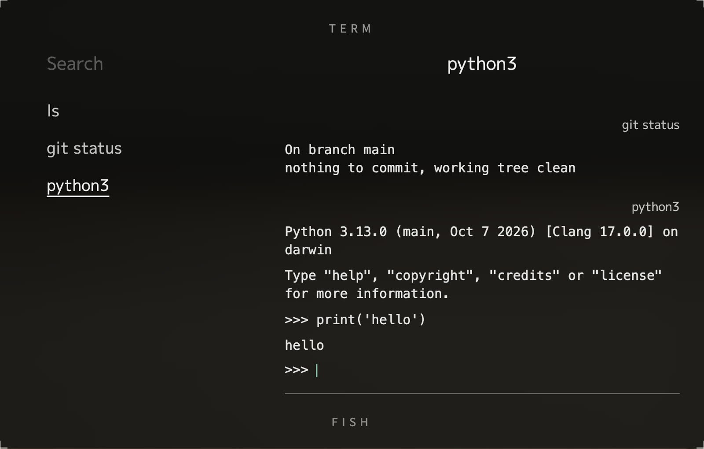
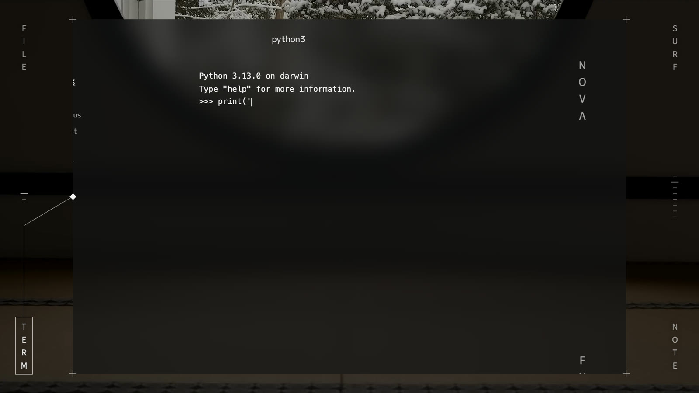

<div align="center">
  
  <h1>re: term</h1>
  <p><em>Talking to the machine in words</em></p>
  <p>A terminal that reads like a conversation.</p>
  <p><a href="https://getrespace.app/download/ReSpace.dmg">Download for Mac</a> · <a href="https://getrespace.app">getrespace.app</a> · <a href="https://ko-fi.com/artursavytskyi">Support</a></p>
</div>

**re: term** is a terminal that reads like a conversation: each command and its answer, one after another, in zsh, bash or fish, and every session kept to go on with later. Programs that want the screen or each key (vim, htop, python, ssh) get the whole window, and a chat with Claude, ChatGPT, Gemini or DeepSeek sits beside the shell.

<p align="center">
  <a href="https://getrespace.app">
    
  </a>
</p>

<details>
  <summary>📸 More pictures</summary>

| Python |
| --- |
|  |

</details>

## What it does

- **Conversation**: Each command and its answer, one after another, read from the top.
- **Shells**: zsh, bash or fish, chosen on the left; its name at the window's foot.
- **Sessions**: Every session kept, to go on with later, or deleted with ⇧⌘⌫.
- **Full screen**: vim, htop, python, ssh and the like take the whole window, keys and all.
- **AI chat**: Claude, ChatGPT, Gemini or DeepSeek beside the shell, through their own programs.

## Part of re: space

re: term is one of five quiet apps for the Mac. Each is fine alone; all five together make one quiet desk.

| | App | |
| :---: | :--- | :--- |
|  | [**re: desk**](https://github.com/artyr1997/ReDesk) | the desk they live on |
|  | [**re: file**](https://github.com/artyr1997/ReFile) | files, and what is in them |
|  | [**re: surf**](https://github.com/artyr1997/ReSurf) | a browser that stays out of the way |
|  | [**re: term**](https://github.com/artyr1997/ReTerm) *(this one)* | a terminal that reads like a conversation |
|  | [**re: note**](https://github.com/artyr1997/ReNote) | notes, in four quiet rooms |

## Install

Download **[ReSpace.dmg](https://getrespace.app/download/ReSpace.dmg)** from [getrespace.app](https://getrespace.app): all five apps, signed and notarized by Apple, so they open without a warning. Open it and drag each app into **Applications**.

Native Swift and AppKit. Runs on **macOS 13 Ventura or later**, on Apple silicon and Intel (one universal app).

## Keys

**General**

| Key | Does |
| :--- | :--- |
| ⌘N | new window |
| ⇧⌘T / ⇧⌘C | TERM / CHAT |
| ⇧⌘F | the whole window |
| ⌘K | new conversation |
| ⇧↑ / ⇧↓ | the conversation above / below |
| ⇧⌘⌫ | delete the conversation |

**TERM**

| Key | Does |
| :--- | :--- |
| ↑ / ↓ | the commands before |
| ⇥ | complete |
| ⌃C | stop / clear the line |
| ⌃D | end of input |
| ⌃Z | suspend |
| ⌘= / ⌘- / ⌘0 | text size |

**CHAT**

| Key | Does |
| :--- | :--- |
| ↩ | send |
| ⇧↩ | new line |
| ⇥ | the next provider |
| Esc | stop the answer |
| ↑ / ↓ | what was said before |

With [re: desk](https://github.com/artyr1997/ReDesk) running, every key here can be set to your own in its keys sheet (⌘/).

## Build from source

With Xcode's command-line tools (Swift 5.9 or later) on macOS 13 or later:

```bash
./build.sh             # build/ReTerm.app, universal (arm64 + x86_64)
./build.sh --install   # and into Applications
```

`build/ReTerm.app/Contents/MacOS/ReTerm --render <folder>` draws its views into pictures, from made-up data.

Built with Swift Package Manager ([SwiftTerm](https://github.com/migueldeicaza/SwiftTerm) 1.20.0); `build.sh` makes one universal app of the arm64 and x86_64 builds. The chat providers are their own command-line programs: `claude`, `codex`, `gemini`, or DeepSeek through Ollama; one not installed shows how to install it.

How it is made, in detail: [docs/DETAILS.md](docs/DETAILS.md).

## Support

re: space is made by one person, slowly and with care. If it makes your days a little calmer, you can [buy me a coffee on Ko-fi](https://ko-fi.com/artursavytskyi).
